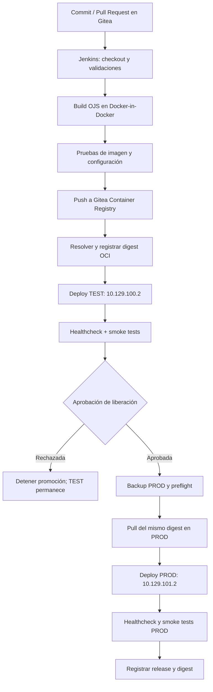

# Diseño de CI/CD para Revista Xitle (OJS)

**Fecha:** 26 de noviembre de 2026  
**Estado:** diseño propuesto; todavía no es un pipeline ejecutable  
**Rama:** `docs/storage-xitle-hostnames`

## 1. Objetivo y principios

Definir el flujo automatizado para construir, probar, publicar y desplegar Revista Xitle (OJS) en DEV/TEST y PROD utilizando la plataforma común Gitea + Jenkins.

Principios obligatorios:

1. **Build once, promote many:** construir una sola imagen de aplicación por commit candidato. La imagen validada en TEST será exactamente la que se promueva a PROD.
2. **Inmutabilidad:** etiquetar la imagen con el SHA completo del commit y desplegar por digest OCI (`sha256:...`), nunca con `latest` ni con una etiqueta mutable como única referencia.
3. **Separación de entornos:** TEST se despliega en el host de control `10.129.100.2` (VLAN 50); PROD en `10.129.101.2` (VLAN 51). Las variables, datos, bases de datos, volúmenes y credenciales son independientes.
4. **Promoción controlada:** PROD requiere aprobación humana explícita después de que TEST pase healthcheck y smoke tests.
5. **Rollback preparado:** conservar el digest anterior y un respaldo consistente de la base de datos y archivos antes de liberar una versión que pueda modificar el esquema o los datos.
6. **Sin secretos en Git ni en los logs:** Jenkins Credentials y archivos locales protegidos en cada host; nunca imprimir tokens, contraseñas, claves o archivos `.env`.
7. **No reconstruir en producción:** el host PROD sólo descarga el digest ya publicado y validado.

## 2. Arquitectura y recorrido



**Componentes existentes y comprobados:**

- Gitea `1.27.1` con Packages/Container Registry habilitado.
- Jenkins en el host de control, con Docker CLI.
- Docker-in-Docker `docker:29-dind`, accesible desde Jenkins por `tcp://docker-dind:2376` con TLS.
- DNS de DinD hacia OPNsense `10.129.100.1`, que resuelve `git.infra.encit.unam.mx` a `10.129.100.2`.
- HTTPS y confianza de la CA interna validados desde Jenkins.
- API de Gitea autenticada y operaciones Registry login/push/pull probadas con una imagen temporal.

**Todavía no comprobado:**

- Estructura final del repositorio `repos/revista`, Dockerfile y contexto exacto de build.
- Versión de OJS, plugins, extensiones PHP y proceso de actualización.
- Conectividad de Jenkins hacia SSH de ambos hosts y mecanismo de despliegue remoto.
- Compose de OJS para TEST y PROD, rutas persistentes y healthcheck real.
- Namespace definitivo del paquete y política de retención.
- Webhook Gitea → Jenkins y job de pipeline desde SCM.

## 3. Identidad de imagen y nomenclatura

Nombre propuesto (el OWNER debe confirmarse en Gitea antes de implementar):

```text
git.infra.encit.unam.mx/<OWNER>/ojs:<GIT_COMMIT_SHA>
git.infra.encit.unam.mx/<OWNER>/ojs@sha256:<OCI_DIGEST>
```

- La etiqueta con SHA completo facilita rastrear el commit.
- El digest OCI es la referencia autoritativa para desplegar y promover.
- Jenkins debe guardar como artefacto de release un manifiesto pequeño con: repositorio Git, commit SHA, fecha UTC, referencia etiquetada, digest, resultado de pruebas y entornos donde se desplegó.
- No incluir secretos ni valores de configuración en ese manifiesto.
- La etiqueta `smoke-1` utilizada en la prueba de Registry fue temporal y no es una versión de OJS.

El OWNER no se fija en este diseño porque aún debe verificarse si el paquete se alojará bajo una organización o bajo la cuenta técnica `jenkins`. Se recomienda un namespace institucional/de proyecto, no usar la cuenta personal de un operador.

## 4. Contrato del repositorio de aplicación

La ruta del Jenkinsfile y el contexto Docker deben confirmarse al inspeccionar `repos/revista`. Como objetivo de organización, el repositorio debería contener:

```text
repos/revista/
├── Jenkinsfile
├── Dockerfile
├── .dockerignore
├── docker/
│   ├── compose.test.yml
│   └── compose.prod.yml
├── config/
│   └── (plantillas no secretas)
└── tests/
    ├── image-smoke.sh
    └── http-smoke.sh
```

Esto es una estructura objetivo, no un inventario de archivos que ya existan. No duplicar configuraciones secretas ni datos persistentes en el repositorio.

La imagen debe encapsular el código de OJS, plugins y dependencias de aplicación fijadas por versión. No debe contener:

- `config.inc.php` de un entorno real ni credenciales.
- Datos de usuarios, artículos, archivos privados o respaldos.
- Volúmenes de datos ni directorios de almacenamiento persistente.
- Claves privadas, certificados TLS o tokens.

La configuración específica de entorno y el almacenamiento persistente se montarán en runtime. La base de datos MariaDB y el directorio de archivos de OJS permanecen fuera de la imagen y tienen ciclo de respaldo propio.

## 5. Etapas del pipeline

### 5.1 Checkout y validación

- Obtener el commit exacto desde Gitea.
- Rechazar builds sin SHA identificable o sobre un workspace sucio.
- Validar sintaxis de Dockerfile, Compose y scripts.
- Ejecutar análisis estático y pruebas disponibles en el repositorio.
- No permitir que PR de forks o ramas no confiables accedan a credenciales de Registry o despliegue.

### 5.2 Build único

- Usar el daemon DinD ya validado.
- Construir desde el contexto acordado de `repos/revista`.
- Etiquetar con SHA completo del commit.
- Aplicar versiones fijadas para imagen base, OJS, plugins y dependencias; evitar `latest`.
- Registrar metadatos OCI de origen (commit y repositorio).
- No pasar secretos de build mediante argumentos Docker ni copiarlos a capas.

### 5.3 Pruebas de imagen

Como mínimo:

- La imagen inicia el proceso esperado.
- Extensiones PHP requeridas y configuración básica están presentes.
- El servidor HTTP interno inicia y responde.
- Los permisos de directorios escribibles son correctos para el usuario de runtime.
- No existen archivos de configuración real ni secretos en las capas.
- Un escaneo de vulnerabilidades puede añadirse cuando se elija herramienta y política.

Estas pruebas no sustituyen la validación de integración con MariaDB ni los smoke tests HTTP del entorno TEST.

### 5.4 Publicación y digest

- Login al Registry con Jenkins Credentials, usando una credencial con mínimo `read:package` y `write:package` para el namespace de publicación.
- Push de la imagen etiquetada por SHA.
- Obtener el digest del manifiesto publicado desde el resultado de push o una consulta verificable al Registry.
- Volver a descargar por digest y verificar que la imagen está disponible.
- Persistir el digest como dato de release del mismo build.
- No utilizar credenciales globales de administrador Gitea.

### 5.5 Despliegue TEST

- Ejecutar sólo después de publicar y verificar el digest.
- Jenkins debe conectarse al host TEST mediante un mecanismo remoto explícito (preferentemente SSH restringido con usuario de despliegue dedicado); la conectividad, host key y autorización todavía deben validarse.
- En TEST, Compose recibe la referencia inmutable por variable de entorno o archivo de release local protegido, por ejemplo `OJS_IMAGE=git.infra.encit.unam.mx/<OWNER>/ojs@sha256:<OCI_DIGEST>`.
- Descargar la imagen por digest y recrear únicamente los servicios de aplicación necesarios.
- No ejecutar `docker compose down -v`, no borrar volúmenes y no reconstruir en el host.
- Ejecutar healthcheck del contenedor y smoke test HTTP contra el hostname TEST real.
- Conservar el digest desplegado y el anterior para diagnóstico/rollback.

### 5.6 Aprobación y despliegue PROD

- Un responsable autorizado aprueba la promoción en Jenkins después del resultado satisfactorio de TEST.
- Antes del cambio: verificar espacio, disponibilidad de Registry, variables/secretos de PROD, backups recientes y estado de MariaDB/almacenamiento.
- Desplegar el mismo digest OCI, sin rebuild ni retag como mecanismo de identidad.
- Ejecutar healthcheck y smoke test sobre `https://xitle.encit.unam.mx`.
- Si falla el healthcheck, detener la liberación, conservar logs y ejecutar el procedimiento de rollback autorizado.
- Registrar quién aprobó, commit, digest, hora, resultado y digest anterior.

## 6. Estrategia de despliegue y persistencia

La aplicación OJS debe ser stateless en cuanto al artefacto de código, mientras que los datos se conservan en volúmenes/directorios persistentes del entorno:

| Componente | TEST | PROD | Tratamiento |
|---|---|---|---|
| Imagen OJS | Host control / VLAN 50 | Host producción / VLAN 51 | Mismo digest inmutable |
| MariaDB | Instancia y volumen exclusivos | Instancia y volumen exclusivos | Nunca compartir entre entornos |
| Archivos de OJS | Almacenamiento exclusivo TEST | Almacenamiento exclusivo PROD | Fuera de la imagen; respaldar |
| Configuración OJS | Archivo local TEST | Archivo local PROD | Fuera de Git; permisos restrictivos |
| TLS / proxy | Nombre interno TEST | Proxy público PROD | Certificados independientes |

El directorio real de archivos de OJS y las rutas de volúmenes deben tomarse del Compose y del diseño de almacenamiento aprobado; no se fijan aquí porque aún no se ha completado la inspección del stack de revista.

## 7. Migraciones y rollback

Una reversión de imagen no garantiza revertir una migración de base de datos. Antes de liberar cambios que alteren esquema, plugins o estructura de archivos:

1. Confirmar compatibilidad de la versión nueva con el esquema existente.
2. Respaldar MariaDB y el almacenamiento de archivos con consistencia temporal.
3. Verificar que el respaldo puede leerse y que existe procedimiento de restauración.
4. Definir si la migración es reversible. Si no lo es, exigir ventana de mantenimiento y plan de recuperación probado.
5. Mantener el digest anterior y la configuración anterior de Compose.
6. En rollback, detener el despliegue nuevo, restaurar imagen/configuración compatibles y, cuando sea necesario, recuperar DB/archivos desde el respaldo consistente.

No automatizar una restauración destructiva como reacción ciega a cualquier healthcheck fallido. La restauración de datos requiere autorización y evaluación del punto de recuperación.

## 8. Credenciales y permisos mínimos

Credenciales lógicas propuestas en Jenkins (los IDs definitivos se crearán después de validar conectividad y método de despliegue):

| Credencial lógica | Uso | Permisos |
|---|---|---|
| Gitea Registry publish | Login/push/pull de imagen OJS | Sólo Packages del namespace OJS |
| Deploy TEST SSH | Ejecutar Compose en TEST | Usuario dedicado; sin sudo irrestricto si puede evitarse |
| Deploy PROD SSH | Ejecutar Compose en PROD | Usuario dedicado; acceso restringido y aprobación previa |

La credencial existente `gitea-jenkins-token` ya permitió push/pull del paquete de prueba. Antes de reutilizarla se debe confirmar su alcance y si conviene separar publicación y lectura. No documentar valores ni generar credenciales durante esta fase.

No reutilizar la misma clave SSH de TEST y PROD. La clave de producción debe tener acceso limitado al host y a las operaciones necesarias. Verificar host keys; no desactivar la validación SSH.

## 9. Disparadores y gobierno del pipeline

- Crear un job Jenkins de tipo Pipeline desde SCM que apunte al Jenkinsfile versionado en el repositorio Gitea.
- Configurar webhook Gitea sólo después de validar autenticación, endpoint y restricción de red.
- Pull Requests: checkout, validaciones y pruebas sin secretos de publicación ni despliegue.
- Rama de integración/release acordada: build, pruebas y publicación del candidato; despliegue TEST según política.
- PROD: promoción del digest ya probado con aprobación manual. No desplegar automáticamente PROD por cada push.
- El job productivo debe ser persistente y estar documentado; no volver a crear jobs inline temporales para pruebas.

Las ramas exactas (por ejemplo, `main` y `release/*`) deben alinearse con la estrategia Git real de `repos/revista`; no se presuponen en este documento.

## 10. Decisiones pendientes antes de escribir el Jenkinsfile ejecutable

| Decisión / evidencia | Motivo | Condición para cerrar |
|---|---|---|
| Inspeccionar `repos/revista` y localizar Dockerfile, Compose, scripts y versiones | Determinar contexto y comandos reales | Inventario de archivos y revisión de contenido |
| Definir rama(s) de build y release | Evitar publicar desde ramas no confiables | Aprobación del flujo Git |
| Definir OWNER y nombre del paquete OJS | Namespace y permisos Registry | Crear/confirmar namespace institucional |
| Confirmar método Jenkins → hosts | No se ha probado SSH ni el usuario de deploy | Prueba de conectividad sin cambiar servicios |
| Confirmar Compose TEST/PROD y rutas persistentes | Evitar sobrescribir datos | Revisión de manifiestos y directorios |
| Definir healthcheck y smoke tests | Criterio objetivo de aceptación | URL y comportamiento esperados |
| Revisar migraciones OJS/plugins | Riesgo de incompatibilidad de datos | Procedimiento probado y backup |
| Definir IDs/alcances de credenciales | Mínimo privilegio | Credenciales aprobadas y almacenadas en Jenkins |
| Definir retención de tags y releases | Evitar borrar imágenes aún desplegadas | Política de retención y limpieza |

## 11. Secuencia de implementación recomendada

1. Inspeccionar `repos/revista` en Gitea y documentar estructura, Dockerfile, Compose, scripts, versión OJS y plugins. Sólo lectura.
2. Revisar y normalizar el contrato de imagen y los Compose de TEST/PROD; separar imagen de configuración y datos.
3. Definir namespace y permisos del paquete en Gitea.
4. Validar conectividad SSH Jenkins → TEST/PROD y diseñar cuentas de despliegue restringidas, sin ejecutar cambios.
5. Escribir Jenkinsfile desde SCM con etapas build/test/push y despliegue TEST.
6. Probar el pipeline en una rama de integración y con un paquete de prueba controlado.
7. Validar backups/restauración y smoke tests de TEST.
8. Añadir aprobación manual y promoción del mismo digest a PROD.
9. Ejecutar el primer despliegue productivo sólo con ventana y autorización explícitas.

## 12. Criterio de aceptación del diseño

El pipeline se considerará listo para producción cuando pueda demostrarse, con registros de Jenkins:

- El commit fuente corresponde a la imagen construida.
- Una única imagen se publica con etiqueta SHA y digest verificable.
- TEST descarga y ejecuta ese digest; healthcheck y smoke tests pasan.
- La aprobación de PROD queda registrada.
- PROD descarga exactamente el mismo digest, sin build.
- Hay respaldo y rollback documentados y ensayados.
- Los secretos no aparecen en logs ni en Git.
- La release registra commit, digest, entornos, aprobación y resultado.

**Conclusión:** la plataforma actual ya probó conectividad autenticada Jenkins → Gitea y push/pull del Container Registry con una imagen temporal. El siguiente trabajo no es desplegar OJS todavía: primero hay que inspeccionar el contenido real de `repos/revista` y cerrar las decisiones de build, persistencia, migraciones y acceso remoto. Este documento define el contrato objetivo sin atribuir al repositorio o a los servidores archivos y capacidades que aún no se han verificado.

## 13. Repositorio Git de aplicación seleccionado (26-nov-2026)

El repositorio institucional destinado al proyecto queda identificado como:

- URL Gitea: [https://git.infra.encit.unam.mx/encit/revista](https://git.infra.encit.unam.mx/encit/revista)
- Organización: `encit`.
- Nombre: `revista`.
- Visibilidad: privada.
- Rama predeterminada confirmada visualmente: `main`.

El repositorio existe y el administrador puede abrirlo desde la interfaz autenticada. La API sin autenticación devolvió HTTP 404, resultado compatible con el ocultamiento de repositorios privados y que no debe interpretarse como inexistencia.

**Estado de inicialización:** no se observa todavía `README.md`; se acordó incorporar `README.md` y `.gitignore` desde el primer commit de contenido. Hasta que se agreguen, no hay evidencia de Dockerfile, Compose, código OJS, plugins ni Jenkinsfile en este repositorio.

Por tanto, el paso de inspección de estructura real se encuentra bloqueado hasta inicializar el repositorio. El siguiente paso es añadir esos dos archivos en `main`, verificar el commit y después inspeccionar el árbol. La estructura objetivo descrita en la sección 4 sigue siendo una propuesta, no un inventario.


## Estado del repositorio de aplicación tras su inicialización (26-nov-2026)

El repositorio privado Gitea `encit/revista` ya no está vacío. Se publicó en la rama `main` el commit inicial `9d1f0ce` (`docs: inicializar repositorio de Revista Xitle`), con autoría institucional de Alan Uriel Gil Casas (`alan.gil@encit.unam.mx`). El commit contiene únicamente:

- `README.md`: propósito, alcance previsto, entornos y principios operativos.
- `.gitignore`: exclusiones iniciales para secretos, configuración local, datos persistentes, artefactos y dependencias.

La identidad de Git se configuró localmente dentro del repositorio, sin alterar la configuración global del host.

Este hito sólo inicializa el control de versiones. No constituye una implementación de OJS. Antes de definir Dockerfile, Compose, Jenkinsfile, plugins o estrategia de persistencia, debe inspeccionarse el contenido real y acordarse la versión y arquitectura de OJS.
