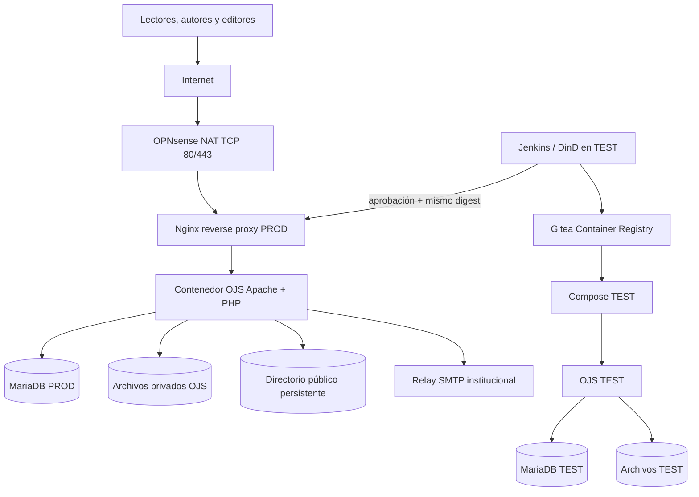

# Diseño técnico de Revista Xitle con Open Journal Systems (OJS)

**Fecha:** 26 de noviembre de 2026  
**Estado:** diseño técnico propuesto; no implementado ni desplegado  
**Repositorio documental:** `Lukisimas/encit`  
**Rama documental:** `docs/storage-xitle-hostnames`  
**Repositorio de aplicación:** Gitea privado `encit/revista`, rama `main`

> Este documento es la referencia técnica principal para construir Revista Xitle. Describe una arquitectura objetivo y decisiones recomendadas. No afirma que existan Dockerfiles, Compose, imágenes OJS, contenedores, bases de datos o instalaciones de OJS en TEST o PROD.

## 1. Propósito, alcance y estado

Diseñar la plataforma de publicación de la revista institucional Xitle sobre Open Journal Systems (OJS), utilizando la infraestructura ENCiT de dos servidores físicos y la plataforma de automatización ya validada.

El alcance incluye:

- Selección de la línea de OJS y plataforma PHP/base de datos.
- Arquitectura lógica y despliegue en contenedores.
- Separación de TEST y PROD.
- Persistencia de base de datos, archivos editoriales y configuración.
- Integración con proxy, TLS, DNS y NAT existentes.
- Construcción de imágenes y flujo CI/CD Gitea–Jenkins.
- Seguridad, respaldos, restauración, monitoreo y criterios de aceptación.

No incluye todavía: instalación de OJS, creación de contenedores, modificación de servidores, generación de secretos, configuración de DNS/OPNsense, elección de plugins editoriales ni puesta en producción.

### Estado comprobado de partida

| Elemento | Estado |
|---|---|
| Host de control/DEV/TEST | `pruebas`, `10.129.100.2/28`, VLAN 50 |
| Gateway VLAN 50 | `10.129.100.1` |
| Host de PROD | `10.129.101.2/28`, VLAN 51 |
| Gateway VLAN 51 | `10.129.101.1` |
| Publicación de Xitle | `xitle.encit.unam.mx` → `132.247.168.166` |
| NAT TCP/80 y TCP/443 | OPNsense hacia `10.129.101.2`, comprobado previamente |
| Gitea | `https://git.infra.encit.unam.mx`, alojado en TEST |
| Repositorio de aplicación | `encit/revista`, privado, rama `main`; sólo inicializado |
| Jenkins / Gitea Registry | Integración autenticada y push/pull de imagen de prueba validados |
| OJS | No instalado; no hay imagen ni Compose de OJS verificados |
| CI/CD de OJS | Diseño pendiente de implementación |
| DNS interno para hostname de TEST | Pendiente de definir |
| Certificado TLS de Xitle | Pendiente de seleccionar/emitir y validar para el servicio |

Los datos de red describen la infraestructura documentada. Cualquier cambio de red, DNS, firewall, NAT o proxy requiere autorización y validación independiente.

## 2. Decisiones arquitectónicas recomendadas

| ID | Decisión propuesta | Motivo / condición |
|---|---|---|
| ADR-XTL-01 | Adoptar OJS 3.5.x; objetivo inicial de paquete 3.5.0-6, sujeto a confirmar descarga oficial y checksum | Línea LTS con mantenimiento activo; el hito 3.5.0-6 figura completado; nunca usar `latest` |
| ADR-XTL-02 | Construir una imagen propia desde el paquete oficial de distribución PKP | Controlar PHP, extensiones, Apache, permisos y procedencia |
| ADR-XTL-03 | Apache + PHP en el contenedor web de OJS | OJS soporta Apache; reduce la complejidad frente a PHP-FPM más otro servidor web interno |
| ADR-XTL-04 | MariaDB 11.8 LTS dedicada para OJS, con base y credenciales independientes por entorno | En el inventario de PROD del 21-nov-2026 no se encontró una instancia MySQL confirmada; evitar acoplar OJS a la base de otra aplicación |
| ADR-XTL-05 | Archivos privados de OJS fuera del document root | Los manuscritos y documentos de revisión no deben ser descargables directamente |
| ADR-XTL-06 | Nginx existente como proxy perimetral/reverse proxy | Reutilizar el punto de entrada institucional; TLS termina en PROD |
| ADR-XTL-07 | TEST y PROD con Compose, redes, datos y secretos independientes | Evitar contaminación cruzada y permitir pruebas seguras |
| ADR-XTL-08 | Build once / promote many por digest OCI | La imagen que pasa TEST es exactamente la que se libera a PROD |
| ADR-XTL-09 | Sin Redis, balanceador, Kubernetes ni almacenamiento compartido en la primera versión | No introducir dependencias sin necesidad demostrada |
| ADR-XTL-10 | Un journal inicial dentro de OJS | OJS permite administrar uno o varios journals; iniciar con Xitle y ampliar sólo si se requiere |

Estas decisiones son una línea base de diseño. Se podrán revisar antes de la implementación si las pruebas de compatibilidad, capacidad o los requisitos editoriales muestran una razón concreta.

## 3. Versión de OJS y plataforma de ejecución

### 3.1 OJS

Se recomienda OJS 3.5.x. El repositorio oficial de PKP identifica 3.5.x como línea con mantenimiento activo y LTS; 3.6.x aparece como pre-release en la política consultada. La política de soporte puede cambiar, por lo que deberá revisarse nuevamente al preparar cada actualización.

Como referencia al 26 de noviembre de 2026, el repositorio de PKP registra el hito de mantenimiento 3.5.0-6. Antes de construir se debe confirmar que ese paquete —o un parche posterior publicado por PKP— sea la última versión estable disponible en la página oficial de descargas.

Reglas de versionado:

- Fijar versión exacta de OJS, no una rama flotante.
- Descargar el paquete oficial de distribución, no construir producción desde la rama `main` del repositorio de desarrollo.
- Registrar URL de origen y SHA-256 del paquete.
- Validar el checksum antes de extraer el código.
- Registrar versión de plugins y tema, junto con su compatibilidad explícita con esa versión de OJS.
- No actualizar OJS ni plugins automáticamente al iniciar un contenedor.

### 3.2 PHP y extensiones

OJS 3.5 requiere PHP 8.2 o posterior. La guía oficial de inicio de PKP señala expresamente PHP 8.2+ y extensiones `mbstring`, `xml` e `intl`. El README oficial del proyecto muestra, además, requisitos de plataforma como `curl`, `dom`, `fileinfo`, `gd`, `intl`, `mbstring`, `openssl`, `simplexml`, `xml`, `xmlwriter`, `zip` y `zlib`; la lista exacta se debe obtener del paquete y verificar con Composer para la versión fijada.

Propuesta inicial:

- PHP 8.2 como mínimo de compatibilidad.
- PHP 8.3 como runtime objetivo inicial, sujeto a ejecutar `composer check-platform-reqs` y pruebas funcionales con OJS 3.5.0-6. Si alguna dependencia no supera las verificaciones, volver a PHP 8.2, manteniendo el mismo runtime en TEST y PROD.
- Fijar la imagen base por versión y digest.
- Mantener iguales PHP y extensiones en TEST y PROD.
- Verificar por separado la configuración de PHP web y CLI: límites de memoria, tiempo de ejecución, tamaño de carga, zona horaria y extensiones.

No fijar aún valores de memoria o límites de carga: deben derivarse del tamaño máximo de manuscritos y anexos que establezca el equipo editorial.

### 3.3 Base de datos

**Decisión de diseño: MariaDB dedicada para OJS**, sin reutilizar una instancia compartida con otras aplicaciones.

Fundamento:

- En la inspección de PROD del 21 de noviembre de 2026 no se encontraron contenedores Docker ni una instancia MySQL confirmada que pudiera reutilizarse.
- OJS 3.5 admite MySQL 5.7.22+ o MariaDB 10.3+; por compatibilidad de plataforma MariaDB es una opción válida. La versión efectiva debe probarse con el paquete OJS fijado.
- MariaDB 11.8 es una rama LTS mantenida. Al 26 de noviembre de 2026, la versión de mantenimiento publicada es **11.8.10**; la serie tiene mantenimiento comunitario anunciado hasta junio de 2028.

Parámetros propuestos:

- Producción: MariaDB **11.8.10**, fijada por tag exacto y digest de imagen.
- TEST: misma versión y digest que PROD, pero instancia, volumen, base y credenciales propios.
- Base de datos exclusiva `ojs_xitle` y usuario de aplicación exclusivo; no compartir credenciales ni esquemas.
- InnoDB y juego de caracteres/collation compatibles con el instalador OJS 3.5. La configuración exacta se valida en TEST.
- Sin publicación del puerto 3306 al host ni a redes externas.
- Acceso sólo desde el contenedor OJS y desde procedimientos administrativos autorizados.
- No usar la imagen `latest`; aplicar actualizaciones de mantenimiento tras pruebas en TEST.

La serie 11.8 tiene un horizonte comunitario más corto que la serie 11.4 (junio de 2028 frente a mayo de 2029, según la política publicada por MariaDB Foundation). Se conserva 11.8 por continuidad con el diseño preliminar ya trabajado y porque es LTS vigente; la política de actualización debe contemplar reevaluar 11.4 antes de la puesta en producción si se prioriza extender el periodo de mantenimiento.

Fuentes de compatibilidad y mantenimiento: README oficial de OJS y política de versiones de MariaDB Foundation. La compatibilidad definitiva se confirma con el paquete OJS descargado y las pruebas de instalación, migración y backup/restauración.
## 4. Arquitectura lógica

### 4.1 Diagrama



El diagrama es conceptual. No representa todavía redes Docker, puertos internos, rutas de host ni una conectividad Jenkins → PROD ya comprobada.

### 4.2 Componentes por entorno

| Componente | TEST — VLAN 50 | PROD — VLAN 51 |
|---|---|---|
| Host físico | `10.129.100.2` | `10.129.101.2` |
| OJS web | Compose de prueba aislado | Compose de producción |
| Base de datos | MariaDB 11.8.10 TEST | MariaDB 11.8.10 PROD |
| Archivos privados | Almacenamiento exclusivo TEST | Almacenamiento exclusivo PROD |
| Configuración | Archivo local protegido TEST | Archivo local protegido PROD |
| Proxy | Nombre interno de prueba por definir | Nginx de producción |
| TLS | Certificado interno si se publica por HTTPS interno | Certificado válido para `xitle.encit.unam.mx` |
| SMTP | Mailpit o relay de pruebas | Relay SMTP institucional |
| Backups | Datos descartables o respaldos de prueba | Política formal y restauración ensayada |
| Imagen OJS | Digest candidato | Mismo digest aprobado |

TEST comparte host físico con Gitea y Jenkins. Por ello debe ser un proyecto Compose independiente, con nombres, redes, volúmenes y límites propios; no debe compartir base de datos, directorios de datos ni secretos con la plataforma de control. Se deben vigilar CPU, RAM y espacio para evitar que builds de Jenkins afecten las pruebas editoriales.

## 5. Diseño de contenedores y redes

### 5.1 Servicios iniciales

**Servicio `ojs-web`**

- Imagen propia basada en Apache + PHP compatible con OJS.
- Código OJS incluido en la imagen, inmutable durante la ejecución.
- Puerto HTTP sólo dentro de la red Docker.
- Sin publicación directa de puertos en la interfaz pública del host.
- Configuración OJS montada desde archivo local protegido.
- Directorios de caché y escritura con permisos explícitos para el usuario del proceso web.
- Healthcheck HTTP local que compruebe que Apache y OJS responden.

**Servicio `mariadb`**

- Imagen oficial MariaDB 11.8.10 fijada también por digest OCI.
- Volumen persistente exclusivo.
- Healthcheck con herramienta de cliente incluida en la imagen.
- Red privada compartida sólo con OJS.
- Sin `ports:` publicados al host.
- Usuario de aplicación separado del usuario administrativo de base de datos.

**Servicio scheduler**

OJS necesita ejecutar tareas programadas para determinadas funciones. No se debe inventar el comando ni el modelo de scheduler: se implementará como servicio separado o tarea del host únicamente después de confirmar en la documentación y paquete exactos de OJS 3.5 el mecanismo soportado. Debe ejecutarse con la misma imagen y configuración que OJS, sin duplicar procesos web.

**Servicios no incluidos inicialmente**

- Redis: no es requisito base de OJS; añadirlo sólo si se justifica con mediciones y soporte de la versión.
- Elasticsearch/OpenSearch: no se incorpora sin un requisito editorial concreto.
- phpMyAdmin/Adminer: no se publicará en ningún entorno.
- Mailpit: sólo para TEST, nunca como relay productivo.
- Segundo proxy Nginx dentro del stack: no es necesario si el proxy existente puede enviar al Apache de OJS por una red controlada.

### 5.2 Redes

Se requieren dos segmentos lógicos:

1. **Red de aplicación:** OJS y MariaDB. No debe ser una red enrutable desde Internet. MariaDB sólo acepta conexiones desde OJS y herramientas administrativas autorizadas.
2. **Red de borde:** sólo OJS web conectado al proxy Nginx existente. La base de datos no debe pertenecer a esta red.

En TEST ya se inventariaron estas redes Docker:

| Red | Subred | Uso observado |
|---|---|---|
| `encit_control_edge` | `172.18.0.0/16` | Red de borde de la plataforma de control |
| Redes internas de control | `172.19.0.0/16`, `172.20.0.0/16`, `172.21.0.0/16` | Redes de servicios internos, Gitea y Jenkins egress |
| `bridge` predeterminada | `172.17.0.0/16` | Red bridge de Docker |

Para TEST, la propuesta es conectar únicamente `ojs-web` a `encit_control_edge` si se confirma que el proxy puede enrutar por esa red. MariaDB permanecerá sólo en la red privada del proyecto OJS. La red privada de Compose se creará sin fijar manualmente una subred/IPAM; Docker seleccionará un rango disponible. No conectar OJS ni MariaDB a las redes internas de Gitea/Jenkins y no reutilizar sus rangos.

En PROD todavía debe inspeccionarse el diseño real de redes Docker y el punto de entrada Nginx antes de fijar el modo de conexión. No asumir que la red de TEST existe también en PROD ni crear subredes que puedan solaparse con redes ya asignadas.

El puerto 3306 no se publicará. El puerto Apache sólo será accesible desde el proxy y la red de aplicación autorizada.

## 6. Proxy, DNS y TLS

### 6.1 Producción

Flujo público previsto:

1. `xitle.encit.unam.mx` resuelve a `132.247.168.166`.
2. OPNsense realiza NAT TCP/80 y TCP/443 hacia `10.129.101.2`.
3. Nginx en PROD recibe las conexiones.
4. Nginx termina TLS y reenvía al contenedor web OJS por la red Docker de borde.
5. OJS recibe el esquema/host original mediante cabeceras proxy confiables.

El administrador confirmó previamente DNS público y NAT. No es parte de este diseño modificar esos elementos.

### 6.2 Certificado y cabeceras

- Emitir u obtener un certificado válido para `xitle.encit.unam.mx`; no asumir que el wildcard interno de `infra.encit.unam.mx` cubre este dominio.
- No reutilizar la clave privada del certificado de infraestructura.
- Redirigir HTTP a HTTPS.
- Configurar TLS moderno, renovación y monitoreo de expiración.
- Configurar `trusted_hosts`, URL base y parámetros proxy de OJS de acuerdo con el dominio real.
- Confiar en `X-Forwarded-Proto` y `X-Forwarded-Host` sólo desde el proxy controlado; no aceptar cabeceras arbitrarias de clientes.
- Establecer límites de tamaño de petición coherentes entre Nginx y PHP.
- Evitar almacenar caché pública de respuestas autenticadas, formularios editoriales o contenido privado.

### 6.3 TEST

Definir un hostname interno de prueba y su registro/override DNS dentro de ENCiT. El nombre definitivo queda pendiente; no publicar TEST en DNS público ni abrirlo desde Internet. El certificado puede ser institucional interno si los clientes de prueba confían en la CA. No modificar OPNsense o DNS sin autorización.

## 7. Persistencia y estructura de datos

La imagen contiene el código y las dependencias; los datos mutables viven fuera de ella.

| Elemento | Persistencia | Exposición |
|---|---|---|
| Código OJS y plugins aprobados | Imagen OCI versionada | Sólo lectura en runtime |
| `config.inc.php` | Archivo local por entorno, montado en runtime | Nunca en Git ni en capas de imagen |
| Base de datos | Volumen/directorio persistente de MariaDB | Sólo red privada |
| `files_dir` | Volumen/directorio persistente fuera del document root | No accesible por HTTP directo |
| `public/` y recursos públicos cargados | Volumen persistente si la operación de OJS lo requiere | Sólo archivos destinados a publicación |
| Caché y temporales | Directorios escribibles; reconstruibles | No respaldar como fuente primaria |
| Logs | stdout/stderr y sistema de logs del host | Acceso administrativo |

La inspección de PROD del 21 de noviembre de 2026 confirmó: SSD RAID1 `/dev/sda2`, ext4, montado en `/`, con aproximadamente 392 GB libres; HDD RAID5 `/dev/sdb1`, ext4, montado persistentemente en `/data`, con aproximadamente 62 TB libres y prácticamente vacío (sólo `lost+found`). Docker utiliza `/var/lib/docker` en el SSD. Se adopta esta distribución lógica para PROD, sin crear aún los directorios:

| Ruta propuesta | Contenido | Medio |
|---|---|---|
| `/srv/encit/data/revista/prod/mariadb` | Datos de MariaDB | SSD RAID1 |
| `/srv/encit/data/revista/prod/config` | Configuración OJS protegida | SSD RAID1 |
| `/srv/encit/data/revista/prod/cache` | Caché de OJS | SSD RAID1 |
| `/data/encit/data/revista/prod/files` | `files_dir` privado, fuera del document root | HDD RAID5 |
| `/data/encit/data/revista/prod/public` | Recursos públicos persistentes de OJS | HDD RAID5 |

Estas rutas son el diseño objetivo, no directorios cuya existencia se haya comprobado ni que se hayan creado. Antes de implementarlas se validarán permisos, propietario/UID de la imagen, capacidad y montaje real. No guardar `files_dir` dentro del document root. El HDD local no constituye por sí solo un backup: las copias de recuperación deberán tener una segunda ubicación independiente del host y de sus discos.

No guardar `files_dir` dentro del directorio público ni dentro de la imagen. Los documentos de envío, revisión y producción editorial pueden contener información no publicada y deben quedar fuera del document root.

## 8. Configuración y secretos

- Mantener una configuración no secreta de referencia versionada, sin credenciales.
- Montar `config.inc.php` desde una ruta local protegida o generarlo de forma controlada al desplegar.
- No incluir valores reales en `.env.example`, Jenkinsfile, Dockerfile, manifiestos de release ni logs.
- Credenciales de MariaDB distintas para TEST y PROD.
- Contraseña administrativa inicial de OJS entregada por un mecanismo seguro y rotada al finalizar la instalación.
- SMTP productivo con credenciales propias y TLS cuando el relay lo soporte.
- Tokens Gitea/Registry y credenciales de despliegue almacenados en Jenkins Credentials.
- Permisos de archivos mínimos: lectura para el proceso web donde corresponda y escritura sólo en caché, directorios públicos necesarios y archivos privados.
- Tras la instalación inicial, impedir que el proceso web modifique el código y restringir la escritura de configuración.
- No montar el socket Docker del host en Jenkins. Mantener el DinD TLS ya validado y limitar los jobs que pueden usar credenciales de despliegue.

## 9. Contrato del repositorio Gitea

Repositorio: `https://git.infra.encit.unam.mx/encit/revista`.

Estructura objetivo recomendada:

```
revista/
├── README.md
├── .gitignore
├── Dockerfile
├── .dockerignore
├── Jenkinsfile
├── docker/
│   ├── compose.test.yml
│   └── compose.prod.yml
├── config/
│   ├── config.inc.php.example
│   └── php.ini
├── scripts/
│   ├── entrypoint-check.sh
│   ├── healthcheck.sh
│   └── backup-verify.sh
├── tests/
│   ├── image-smoke.sh
│   └── http-smoke.sh
└── docs/
    ├── ADR/
    ├── OPERACION.md
    └── BACKUP_RESTORE.md
```

Esta estructura es una propuesta, no un inventario del repositorio remoto. El paquete oficial de OJS no se debe versionar como código de terceros salvo que exista una razón de mantenimiento/licenciamiento explícita; el Dockerfile descargará una versión exacta y verificará su checksum. No almacenar datos, archivos editoriales, `.env`, certificados ni claves privadas en Git.

## 10. CI/CD Gitea–Jenkins

La arquitectura de CI/CD ya está definida en `docs/18_DISENO_CICD_XITLE_OJS.md`. Este documento la concreta a nivel de aplicación.

### 10.1 Flujo

1. Commit o Pull Request en Gitea.
2. Jenkins obtiene el commit exacto y ejecuta validaciones.
3. Descarga el paquete oficial OJS fijado y verifica SHA-256.
4. Construye una sola imagen con PHP, extensiones, Apache, código OJS y plugins aprobados.
5. Ejecuta pruebas de plataforma, configuración, permisos, ausencia de secretos y arranque.
6. Publica en Gitea Container Registry con etiqueta del SHA completo.
7. Recupera y registra el digest OCI del manifiesto.
8. Despliega el digest en TEST.
9. Ejecuta pruebas HTTP y pruebas funcionales editoriales.
10. Espera aprobación humana.
11. Verifica backup y preflight de PROD.
12. Descarga y despliega exactamente el mismo digest en PROD.
13. Ejecuta smoke tests, registra resultado y conserva el digest anterior.

### 10.2 Identidad de imagen

Nombre lógico propuesto, pendiente de confirmar namespace de Packages:

```
git.infra.encit.unam.mx/encit/ojs:<GIT_COMMIT_SHA>
git.infra.encit.unam.mx/encit/ojs@sha256:<OCI_DIGEST>
```

El digest es la identidad de despliegue. No usar `latest` ni reconstruir en PROD. El paquete temporal `jenkins/registry-smoke-test:smoke-1` es sólo una prueba de Registry y no representa una imagen de OJS.

### 10.3 Límites de confianza

- Pull Requests y ramas no confiables: sin credenciales de push ni despliegue.
- Credencial de publicación: permiso mínimo para escribir el paquete OJS.
- TEST: credencial de despliegue restringida al stack de prueba.
- PROD: credencial separada, acceso restringido y aprobación manual.
- Validar host keys SSH; no desactivar comprobación de identidad.
- No imprimir secretos ni usar argumentos de build para credenciales.
- La conexión Jenkins → PROD aún debe validarse; no se da por existente.

## 11. Operación de OJS

### 11.1 Correo

TEST debe usar Mailpit o un relay de pruebas. PROD debe usar un relay SMTP institucional autorizado, con remitente institucional, autenticación y TLS según política. Validar SPF, DKIM y DMARC con el área responsable si aplica. No enviar correo real desde TEST.

### 11.2 Tareas programadas

OJS 3.5 sustituyó el mecanismo anterior por Laravel Task Scheduler. El script de línea de comandos documentado para esta versión es:

```
php lib/pkp/tools/scheduler.php run
```

Para producción se propone ejecutarlo mediante el planificador del sistema operativo cada minuto, como el mismo usuario que ejecuta PHP/OJS, desde un servicio scheduler separado o una tarea controlada del host. La plantilla oficial advierte que el scheduler web integrado no es recomendable para sitios de alto volumen y muestra el cron cada minuto. Por tanto:

- Configurar el mecanismo de línea de comandos, no el antiguo `tools/runScheduledTasks.php`.
- Usar exactamente la misma imagen, configuración y versión de OJS que el contenedor web.
- Evitar ejecutar dos schedulers concurrentes sin validar los mecanismos de bloqueo de OJS.
- Registrar salida y errores, y alertar si deja de ejecutarse.
- Validar tareas y colas de trabajo con la versión exacta de OJS antes de PROD.

La frecuencia propuesta es un minuto, siguiendo la plantilla y documentación de PKP; ajustar sólo si las pruebas y necesidades editoriales lo justifican.

### 11.3 Plugins e integraciones editoriales

No instalar plugins por anticipado. Antes de incorporarlos, registrar:

- Necesidad editorial que resuelven.
- Versión compatible con OJS exacto.
- Procedencia y mantenimiento.
- Dependencias PHP/servicios externos.
- Datos personales o credenciales que procesan.
- Procedimiento de actualización y rollback.

ORCID, DOI/Crossref, ROR, preservación digital, antiplagio, estadísticas e indexación se tratarán como requisitos funcionales/editoriales por validar. No asumir que están configurados por instalar OJS.

### 11.4 Monitoreo y logs

- Healthcheck de MariaDB y OJS.
- Logs Apache/PHP/OJS a stdout/stderr o colector administrado.
- Logs de Nginx y accesos HTTP.
- Alertas por espacio, inodos, memoria, CPU, reinicios, errores 5xx, expiración TLS y fallos de backup.
- No registrar contraseñas, tokens, cookies de sesión ni contenido de manuscritos.
- Integrar Prometheus/Grafana y Loki/Promtail cuando la plataforma institucional esté implementada y se defina su alcance; no son dependencias para el primer despliegue.

## 12. Seguridad

1. Mantener PROD sólo en VLAN 51 y permitir tráfico entrante público únicamente a través de OPNsense/Nginx.
2. No exponer MariaDB, PHP/Apache, Jenkins, Gitea ni Mailpit a Internet.
3. No publicar puertos de base de datos en el host.
4. Mantener la base de datos en red privada y usar cuentas con privilegios mínimos.
5. Proteger `files_dir` fuera del document root.
6. Aplicar actualizaciones de seguridad de sistema base, PHP, Apache, MariaDB, OJS y plugins con ventana y respaldo.
7. Escanear imagen y dependencias antes de liberar; elegir herramienta y política de severidad antes de convertirlo en bloqueo de pipeline.
8. Usar imagen base mínima, paquetes fijados, usuario no privilegiado cuando sea compatible con el paquete y permisos explícitos.
9. Limitar tamaño de carga, tiempo de ejecución y tipos de archivos según necesidad editorial.
10. Aplicar políticas de cuentas, contraseñas, roles, administración y MFA cuando OJS/entorno lo permita.
11. Proteger sesiones y cookies con HTTPS y atributos seguros.
12. Definir política de conservación y eliminación de manuscritos, datos de usuarios y respaldos con el área editorial y las políticas institucionales.

## 13. Backups, recuperación y rollback

La unidad de respaldo no es sólo la base de datos. Deben coordinarse:

- Base de datos MariaDB.
- `files_dir` completo.
- Directorios públicos persistentes que contengan archivos cargados o personalizados.
- Configuración local de OJS, sin exponerla.
- Versiones de imagen, plugins y manifiesto de release.

Para una copia consistente, coordinar la exportación de la base con una instantánea/copia de archivos en un periodo sin escrituras o con una ventana de mantenimiento. Verificar que el mecanismo de backup elegido sea consistente con el motor y volumen utilizados.

Política propuesta, pendiente de aprobar:

- Copias diarias y semanales.
- Copia adicional antes de cada actualización de OJS, plugins o esquema.
- Copia fuera del host de producción o en almacenamiento independiente.
- Cifrado en reposo y control de acceso.
- Retención y RPO/RTO definidos con responsables institucionales.
- Prueba periódica de restauración en TEST aislado.

Rollback de aplicación:

1. Detener la promoción.
2. Volver a la imagen anterior por digest si el esquema de base de datos sigue siendo compatible.
3. Si hubo migración de esquema o modificación irreversible de datos, evaluar restauración coordinada de DB y archivos desde backup.
4. No automatizar restauraciones destructivas ante cualquier fallo HTTP.
5. Registrar el incidente, digest, backup utilizado y resultado.

No liberar una actualización que modifique el esquema sin respaldo previo y procedimiento de recuperación ensayado.

## 14. Capacidad y almacenamiento

### PROD — inventario confirmado

- SSD RAID1: `/dev/sda2`, ext4, montado en `/`, aproximadamente 392 GB libres; Docker Root Dir en `/var/lib/docker`.
- HDD RAID5: `/dev/sdb1`, ext4, montado en `/data`, aproximadamente 62 TB libres; montaje persistente por UUID.
- No se encontraron contenedores Docker en el inventario del 21-nov-2026.

La distribución de rutas propuesta para OJS se detalla en la sección 7. La base de datos y configuración se ubican en SSD; archivos privados y públicos editoriales en HDD.

### TEST — información pendiente

El inventario de TEST confirma las redes Docker y los servicios de la plataforma de control, pero no hay evidencia suficiente de discos físicos, RAID, filesystem, capacidad libre, montajes o Docker Root Dir. Por tanto, no se deben crear todavía rutas de persistencia ni asignar cuotas en ese host. Antes de implementar OJS TEST se requiere una inspección de sólo lectura de almacenamiento y capacidad.

### Dimensionamiento

No se asignan todavía CPU, RAM, límites de carga ni cuotas: faltan métricas de uso editorial. Antes de crear volúmenes:

- Medir capacidad, IOPS aproximadas y política de respaldo en ambos hosts.
- Dimensionar archivos según manuscritos, galeras, PDFs, imágenes y crecimiento esperado.
- Definir umbrales de alerta y margen de crecimiento.
- No confundir espacio libre en el HDD local con un backup independiente.

## 15. Pruebas de aceptación

### 15.1 Construcción

- [ ] Versión exacta OJS 3.5.x y checksum oficial registrados.
- [ ] PHP y extensiones validados con Composer y runtime web/CLI.
- [ ] Imagen construida sin secretos ni datos de entorno.
- [ ] Usuario, permisos y directorios escribibles comprobados.
- [ ] Imagen escaneada y digest registrado.

### 15.2 TEST

- [ ] Compose TEST separado de Gitea/Jenkins.
- [ ] MariaDB saludable y sin puerto publicado.
- [ ] OJS inicia detrás del proxy interno.
- [ ] Instalación inicial de OJS completada.
- [ ] Journal Xitle creado y configuración institucional revisada.
- [ ] Acceso de lector, autor, revisor, editor y administrador probado.
- [ ] Envío de manuscrito de prueba y carga de archivos probados.
- [ ] Flujo editorial de prueba recorrido hasta publicación.
- [ ] `files_dir` no es accesible por URL directa.
- [ ] Correo de prueba recibido en Mailpit.
- [ ] Tareas programadas ejecutadas y verificadas.
- [ ] Backup y restauración de TEST ensayados.
- [ ] Healthcheck y smoke tests automatizados.

### 15.3 PROD

- [ ] Certificado TLS válido para `xitle.encit.unam.mx`.
- [ ] Proxy, cabeceras y redirección HTTP→HTTPS verificados.
- [ ] Secrets y configuración PROD independientes de TEST.
- [ ] Backups recientes y restauración ensayada.
- [ ] Aprobación explícita de la liberación.
- [ ] PROD descarga exactamente el digest probado en TEST.
- [ ] Smoke tests externos y funcionales satisfactorios.
- [ ] Monitoreo de espacio, errores, logs y backups habilitado.
- [ ] Procedimiento de rollback disponible y responsable de guardia definido.

## 16. Secuencia de implementación

La ejecución se dividirá en fases con evidencia al cierre de cada una:

1. **Aprobación del diseño:** revisar decisiones ADR, dominio de prueba, almacenamiento, SMTP y requisitos editoriales.
2. **Inspección de almacenamiento:** lectura de discos/montajes/capacidad en ambos hosts; decidir rutas sin sobrescribir datos existentes.
3. **Preparación del repositorio:** clonar el repositorio Gitea sólo para iniciar el trabajo de implementación; conservar su contenido inicial y trabajar en ramas/commits revisables.
4. **Construcción de imagen:** Dockerfile, paquete OJS fijado, extensiones, Apache, healthcheck y pruebas locales.
5. **Compose TEST:** MariaDB, OJS, redes y persistencia aisladas.
6. **Instalación funcional TEST:** instalar OJS, configurar Xitle, probar flujo editorial, correo y scheduler.
7. **Backups TEST:** demostrar restauración de base y archivos.
8. **Pipeline Jenkins:** build, test, push, digest y despliegue TEST.
9. **Preparación PROD:** configuración, secretos, TLS, almacenamiento, backups y preflight; no modificar OPNsense/DNS.
10. **Promoción controlada:** aprobación, mismo digest, smoke tests y registro de release.
11. **Operación:** monitoreo, parches, backups, revisiones de plugins y ejercicios de recuperación.

Cada fase debe documentarse con evidencia y no se marcará como implementada por el solo hecho de que exista el archivo de configuración.

## 17. Riesgos y decisiones abiertas

| Tema | Riesgo | Evidencia/decisión requerida |
|---|---|---|
| Parche exacto OJS | Instalar versión desactualizada | Objetivo 3.5.0-6; confirmar paquete oficial y checksum antes de construir |
| PHP 8.3 vs 8.2 | Incompatibilidad de extensiones/plugins | PHP 8.3 objetivo; ejecutar Composer platform check y pruebas en TEST |
| MariaDB 11.8.10 | Compatibilidad y ciclo de soporte | Versión propuesta; validar con OJS 3.5.0-6 y revisar horizonte LTS antes de PROD |
| Scheduler OJS 3.5 | Tareas editoriales no ejecutadas o duplicadas | Confirmar mecanismo oficial para release fijado |
| Almacenamiento PROD | Pérdida/insuficiencia de espacio | Inspección de montajes y capacidad |
| Host compartido TEST | Builds afectan pruebas | Límites de recursos y ventana de build |
| Redes Docker | Solapamiento de subredes | Inspeccionar redes y rutas antes de conectar proxy |
| Certificado TLS | Dominio sin certificado adecuado | Emitir/validar certificado de Xitle |
| SMTP | Correos editoriales no entregados | Confirmar relay, remitente y autenticación |
| Plugins | Incompatibilidad o vulnerabilidades | Inventario funcional y matriz de compatibilidad |
| Backups | Copia incompleta o no restaurable | Prueba integral DB + archivos |
| SSH de Jenkins a hosts | Despliegue no disponible/seguro | Validar conectividad, host keys y cuentas restringidas |
| RPO/RTO | Recuperación no alineada a necesidades | Aprobación institucional/editorial |

## 18. Referencias técnicas

- PKP, **Getting Started with OJS 3.5**: https://github.com/pkp/pkp-docs/blob/main/admin-guide/en/getting-started.md
- PKP, **OJS README / requisitos de plataforma**: https://github.com/pkp/ojs/blob/main/README.md
- PKP, **OJS 3.5 Release Notebook (cambios del Task Scheduler)**: https://github.com/pkp/pkp-docs/blob/main/dev/release-notebooks/en/3.5-release-notebook.md
- PKP, **Plantilla de configuración OJS 3.5 (scheduler y job runner)**: https://github.com/pkp/ojs/blob/main/config.TEMPLATE.inc.php
- PKP, **Security Policy / versiones soportadas**: https://github.com/pkp/ojs/security/policy
- PKP, **Documentación y guías oficiales**: https://docs.pkp.sfu.ca/
- PKP, **Descargas oficiales de OJS**: https://pkp.sfu.ca/software/ojs/

Consultar estas fuentes al construir y actualizar. Las versiones y requisitos pueden cambiar; el paquete exacto descargado y su README son la autoridad final para la implementación.

---

## Registro de estado

**26 de noviembre de 2026 — Primera versión del diseño técnico**

- Se establece OJS 3.5.x con objetivo de paquete 3.5.0-6, pendiente de comprobar descarga oficial y checksum.
- Se propone PHP 8.3, condicionado a Composer platform check y pruebas funcionales.
- Se adopta MariaDB 11.8.10 como versión candidata fijada por tag/digest, con bases separadas en TEST y PROD.
- Se documentan rutas objetivo de persistencia PROD sobre SSD RAID1 y HDD RAID5; no se han creado.
- TEST requiere inventario de almacenamiento antes de definir rutas persistentes.
- Se separan claramente TEST y PROD.
- Se establece que el repositorio Gitea contiene únicamente su inicialización y que la implementación OJS no existe todavía.
- Se define que clonar el repositorio será una actividad de implementación posterior, no un requisito para diseñar la arquitectura.
- No se realizaron cambios en hosts, contenedores, DNS, OPNsense ni servicios.


## Anexo — Validación de almacenamiento y redes en ambos entornos (26-nov-2026)

La inspección física realizada el 26-nov-2026 confirma el estado real siguiente. Este anexo prevalece sobre las frases anteriores que indicaban que los directorios de PROD aún no estaban creados o que faltaba inventariar el almacenamiento TEST.

### TEST — host `pruebas` (10.129.100.2)

- Disco único `/dev/sda`, 931.5 GiB; partición ext4 `/dev/sda1` montada en `/`, 901 GiB de tamaño y 847 GiB disponibles en la inspección.
- No se observó segundo disco ni montaje `/data`; `/srv` y `/var/lib/docker` resuelven al filesystem raíz. Docker Root Dir: `/var/lib/docker`.
- No existe todavía `/srv/encit/data/revista`. La estructura persistente existente contiene Gitea (`data`, `postgres`) y Jenkins (`home`), con 340 MiB aproximados en total.
- Se propone para OJS TEST `/srv/encit/data/revista/test/{mariadb,files,public,config,cache}`, todo sobre el SSD. Son rutas de diseño; no se han creado.
- Redes Docker confirmadas: `encit_control_edge` 172.18.0.0/16 (gateway 172.18.0.1); `encit-control-platform_jenkins_internal` 172.19.0.0/16; `encit-control-platform_gitea_internal` 172.20.0.0/16; `encit-control-platform_jenkins_egress` 172.21.0.0/16. Las tres redes de plataforma no deben reutilizarse para OJS.
- OJS web podrá conectarse a la red edge y a una red privada propia; MariaDB sólo a la red privada. La subred privada se dejará a la asignación dinámica de Docker.

### PROD — host `produccion` (10.129.101.2)

- SSD `/dev/sda2`, ext4 en `/`, 415 GiB de tamaño y 392 GiB disponibles en la inspección. Docker Root Dir: `/var/lib/docker`.
- HDD `/dev/sdb1`, ext4 montado en `/data`, 65.5 TiB nominales y aproximadamente 62 TiB disponibles.
- La estructura de Revista Xitle ya existe y está vacía en el momento de la inspección:
  - SSD: `/srv/encit/data/revista/prod/mariadb` (root:root, 750), `config` y `cache` (www-data:www-data, 750).
  - HDD: `/data/encit/data/revista/prod/files` y `public` (www-data:www-data, 750).
- Las rutas de las aplicaciones Cursos, Moodle, SIIA y Web también existen; no deben modificarse.
- Red `encit_prod_edge`: 172.18.0.0/16, gateway 172.18.0.1. No había contenedores, incluidos detenidos, en el inventario Docker de esta inspección.
- La subred 172.18.0.0/16 también se utiliza en TEST, pero los hosts son distintos; no hay colisión local entre los daemons Docker. Evaluar rutas/VPN sólo si se requiere comunicación entre hosts mediante esas redes.

### Decisiones consolidadas y límites

- TEST usa un único filesystem para DB y archivos; PROD separa DB/config/cache en SSD y archivos privados/públicos en HDD.
- Los directorios PROD observados están vacíos. Su existencia no significa que MariaDB u OJS estén instalados.
- No se han creado ni iniciado contenedores OJS/MariaDB, no se han cambiado propietarios/permisos y no se han modificado DNS, OPNsense, NAT o proxy.
- Antes de crear volúmenes se deben validar UID/GID efectivos de las imágenes fijadas y el mapeo exacto de directorios que exige el paquete OJS. El directorio `files` debe permanecer fuera del document root.
- El almacenamiento local de PROD no sustituye una copia de seguridad independiente del host; falta decidir destino y probar restauración DB + archivos.


## Anexo de verificación física de almacenamiento y redes (26-nov-2026)

Esta sección actualiza las previsiones de almacenamiento que aparecen en las secciones anteriores. Prevalece sobre cualquier frase anterior que indicara que las rutas de PROD no existían o no habían sido creadas.

### TEST — host `pruebas`

- Disco único observado: `/dev/sda`, 931.5 GiB; partición ext4 `/dev/sda1` montada en `/`; 847 GiB disponibles en la inspección.
- No se observó segundo disco ni montaje `/data`.
- Docker Root Dir: `/var/lib/docker`, dentro del filesystem raíz.
- `/srv/encit/data` existe, propietario `root:root`, modo 755, con 340 MB ocupados.
- Contenido identificado: `gitea/data`, `gitea/postgres` y `jenkins/home`; no se identificó directorio de Revista Xitle.
- Se propone para TEST, todavía sin crear: `/srv/encit/data/revista/test/{mariadb,files,public,config,cache}`. Todo residirá en el filesystem raíz.
- Redes observadas: `encit_control_edge` 172.18.0.0/16; `encit-control-platform_jenkins_internal` 172.19.0.0/16; `encit-control-platform_gitea_internal` 172.20.0.0/16; `encit-control-platform_jenkins_egress` 172.21.0.0/16. No reutilizar las redes internas de Gitea/Jenkins.
- Contenedores activos observados: Docker-in-Docker, Jenkins, Gitea, PostgreSQL de Gitea, proxy Nginx y Mailpit.

### PROD — host `produccion`

- SSD `/dev/sda2`, ext4, montado en `/`; 392 GB disponibles en la inspección. Docker Root Dir: `/var/lib/docker`.
- HDD `/dev/sdb1`, ext4, montado en `/data`; 62 TB disponibles. UUID observado: `5d642b08-fac8-48fa-8f9b-5976c66af37c`.
- La red `encit_prod_edge` existe con driver bridge, subred `172.18.0.0/16`, gateway `172.18.0.1`.
- No se observaron contenedores, incluidos detenidos, en el inventario ejecutado.
- Las cinco rutas de persistencia de Xitle existen y estaban vacías en la inspección:
  - SSD: `/srv/encit/data/revista/prod/mariadb` (`root:root`, 750), `config` y `cache` (`www-data:www-data`, 750).
  - HDD: `/data/encit/data/revista/prod/files` y `public` (`www-data:www-data`, 750).
- Los directorios padre `/srv/encit/data/revista`, `/srv/encit/data/revista/prod`, `/data/encit/data/revista` y `/data/encit/data/revista/prod` son `root:www-data`, modo 750.
- No cambiar propietarios ni permisos hasta verificar los UID/GID de las imágenes fijadas.

### Decisión de persistencia

PROD conserva MariaDB/configuración/caché en SSD y `files_dir`/archivos públicos en HDD. TEST usa el único filesystem disponible para sus datos de prueba, en rutas separadas por aplicación y entorno. El HDD de PROD no es por sí solo un respaldo independiente.

### Pendiente antes de fijar permisos

La identidad `www-data` del host no demuestra por sí sola que la imagen final use el mismo UID/GID. La identidad del proceso MariaDB tampoco debe suponerse. Se inspeccionarán las imágenes exactas y sus digests en TEST; después se validará el mapeo con los directorios host, sin cambiar aún permisos en PROD.

### Verificación de imágenes base y UID/GID (26-nov-2026)

Inspección ejecutada en TEST (host pruebas) mediante imágenes oficiales, sin montar volúmenes ni iniciar servicios persistentes:

- PHP Apache: etiqueta php:8.3-apache-bookworm; versión PHP observada 8.3.37. Digest: php@sha256:353569a793b80b5e7e90bd750f5939e21b9f2a96b22cf77d6fa86cb0fc23570f. La cuenta www-data existe como UID:GID 33:33.
- MariaDB: etiqueta exacta mariadb:11.8.9; versión de paquete observada 1:11.8.9+maria~ubu2404. Digest: mariadb@sha256:e1d5495f445654134f226f55a41ce0da227116f6f27f283101f405c794d841fc. La cuenta mysql existe como UID:GID 999:999.
- Ambas inspecciones de identidad se ejecutaron con shell temporal como root dentro de la imagen. Esto no demuestra por sí solo el UID efectivo de todos los procesos tras completar el entrypoint; debe comprobarse al validar el arranque real y los montajes.
- La etiqueta MariaDB inicialmente propuesta 11.8.10 no se confirmó disponible; se sustituyó por 11.8.9, que sí se descargó. Para reproducibilidad, fijar los digests registrados y no depender sólo de etiquetas mutables.
- No se cambiaron propietarios/permisos de directorios del host, no se crearon volúmenes ni se desplegaron servicios.

**Criterio provisional de permisos:** www-data = 33:33 para los directorios web que realmente requiera escribir la imagen OJS; mysql = 999:999 para el datadir MariaDB. Antes de aplicar chown en PROD, validar el entrypoint, el usuario efectivo del proceso y los requisitos concretos del montaje en un despliegue aislado de TEST.

### Validación de UID/GID efectivos tras el arranque (26-nov-2026)

Se ejecutaron contenedores temporales en TEST, con red none, sin puertos publicados y sin montar directorios del host. Ambos servicios arrancaron correctamente:

- Apache, imagen php:8.3-apache-bookworm: proceso maestro `apache2 -DFOREGROUND` como root (UID:GID 0:0); procesos worker como www-data (UID:GID 33:33).
- MariaDB, imagen mariadb:11.8.9: proceso `mariadbd` como mysql (UID:GID 999:999). El healthcheck de inicialización terminó satisfactoriamente.
- Los contenedores se crearon sólo para la prueba y el bloque de ejecución incluyó su eliminación automática al finalizar.
- No se montaron directorios persistentes, no se cambiaron propietarios/permisos del host y no se modificó PROD.

**Conclusión:** queda confirmado que los workers de Apache usan 33:33 y que MariaDB ejecuta el proceso principal con 999:999. Para los directorios web que Apache deba escribir se considera www-data 33:33; para el datadir MariaDB, mysql 999:999. La asignación concreta de permisos debe respetar el principio de mínimo privilegio y el mapeo final de volúmenes OJS; no hacer un chown recursivo general de todos los directorios.

### Estructura lógica de OJS 3.5.0-6 y límites de escritura (27-nov-2026)

Se revisó el código fuente oficial PKP en la etiqueta `3_5_0-6`, junto con la guía oficial de administración 3.5:

- La raíz de la aplicación contiene `index.php`, `config.TEMPLATE.inc.php`, `cache/`, `public/`, `plugins/`, `lib/`, entre otros directorios.
- En el árbol de esa etiqueta existen `cache/_db`, `cache/t_cache`, `cache/t_compile` y `cache/t_config`; `public/` incluye `index.html`.
- `config.inc.php` se crea en la raíz de OJS a partir de `config.TEMPLATE.inc.php`.
- El template configura `files_dir = files` como valor predeterminado y `public_files_dir = public`. La guía oficial de despliegue exige que `files_dir` quede fuera del web root para proteger manuscritos y archivos privados.
- La guía oficial identifica el paquete estable OJS 3.5 y requiere PHP 8.2+, con extensiones mbstring, xml e intl; la imagen PHP 8.3 elegida satisface la versión base, pero falta verificar extensiones y requisitos del paquete descargable.
- En OJS 3.5 el scheduler usa `lib/pkp/tools/scheduler.php`; sus registros se guardan bajo `<files_dir>/scheduledTaskLogs`.

**Mapeo lógico previsto, sujeto a inspección del paquete descargable y prueba en TEST:**

- Código OJS: dentro de la imagen, raíz de aplicación `/var/www/html`; no persistir el árbol completo como bind mount.
- Configuración: archivo `config.inc.php` en la raíz de OJS, respaldado desde el directorio host `config`.
- Caché: `/var/www/html/cache`, persistida desde el directorio host `cache`.
- Archivos públicos: `/var/www/html/public`, persistidos desde el directorio host `public`.
- Archivos privados: `files_dir` en una ruta fuera de `/var/www/html`, persistida desde el directorio host `files`.
- MariaDB: datadir `/var/lib/mysql`, persistido desde el directorio host `mariadb`.

**Precaución con bind mounts vacíos:** montar el directorio host `public` o `cache` encima de los directorios de la imagen oculta su contenido inicial. Antes de montar, se debe comprobar si el paquete trae archivos de protección o subdirectorios necesarios y sembrarlos en el volumen persistente. No aplicar todavía `chown` ni cambios de permisos en TEST o PROD.

Fuentes oficiales consultadas: [OJS 3.5.0-6 source tree](https://github.com/pkp/ojs/tree/3_5_0-6), [configuration template](https://github.com/pkp/ojs/blob/3_5_0-6/config.TEMPLATE.inc.php), [PKP Admin Guide — Deployment](https://docs.pkp.sfu.ca/admin-guide/en/deploy), [PKP Admin Guide — Getting Started](https://docs.pkp.sfu.ca/admin-guide/en/getting-started), [Scheduled Tasks](https://docs.pkp.sfu.ca/admin-guide/en/deploy-scheduled-tasks).

### Inspección del paquete oficial OJS 3.5.0-6 (27-nov-2026)

En TEST se descargó el paquete desde `https://pkp.sfu.ca/ojs/download/ojs-3.5.0-6.tar.gz`. La descarga fue de 120,980,607 bytes; `tar -tzf` pudo leer el archivo completo. SHA-256 calculado: `f5b85703b06e45cc82e56ef72b0a8f42a2f75237e5204dbd0146d9730a627c97`. Este hash es el observado localmente; no se cotejó con un checksum publicado por PKP.

Hallazgos del contenido:
- La raíz del paquete contiene `config.inc.php` y `config.TEMPLATE.inc.php`; inspeccionar el contenido de `config.inc.php` antes de usarlo o decidir el proceso de generación.
- `cache/` contiene los directorios `_db`, `t_cache`, `t_compile` y `t_config`; no se encontraron archivos `.gitignore` en esas rutas del tarball.
- `public/` contiene `index.html` de cero bytes.
- El template configura `files_dir = files` y `public_files_dir = public`.
- El README del paquete indica PHP 8.2+ y lista requisitos Composer/platform como bcmath, curl, dom, fileinfo, ftp, gd, intl, openssl, simplexml, xml, xmlwriter y zip; mbstring aparece cubierto por polyfill en la salida de Composer incluida en README. Verificar el runtime real con `php -m` y Composer antes de construir la imagen definitiva.

Implicaciones para volúmenes: los bind mounts vacíos sobre `cache` y `public` ocultan el contenido incluido en la imagen. Inicializar los subdirectorios cache y el archivo vacío `public/index.html` en el volumen persistente antes de montar, o diseñar una inicialización controlada que los siembre. No copiar el `config.inc.php` incluido sin revisar sus valores y secretos de ejemplo. No se extrajo el paquete en rutas persistentes ni se cambiaron permisos.
